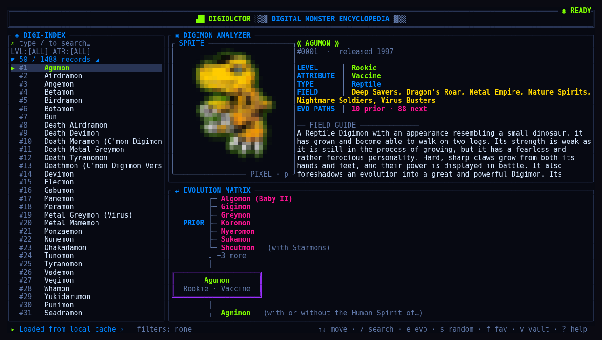
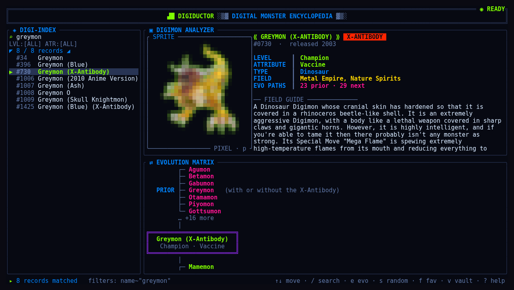
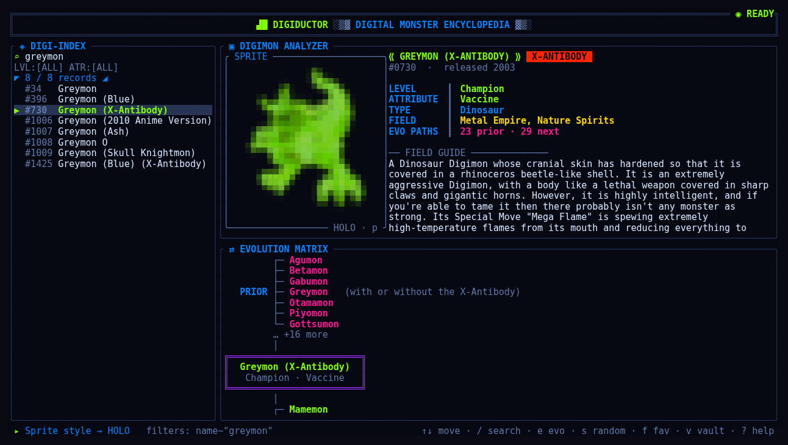
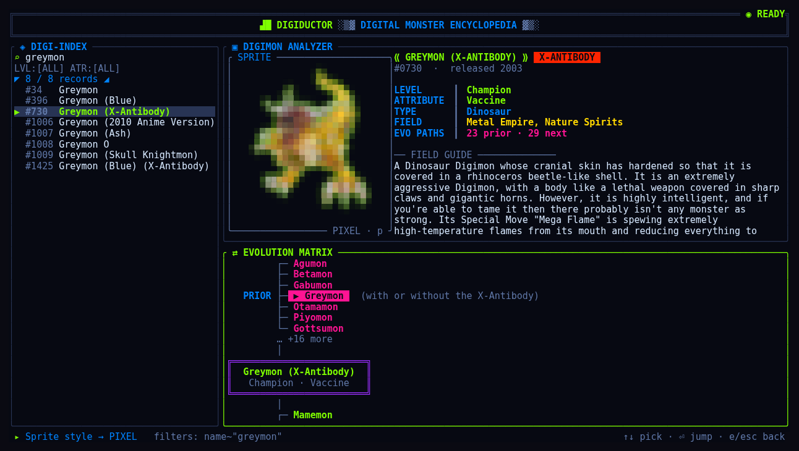
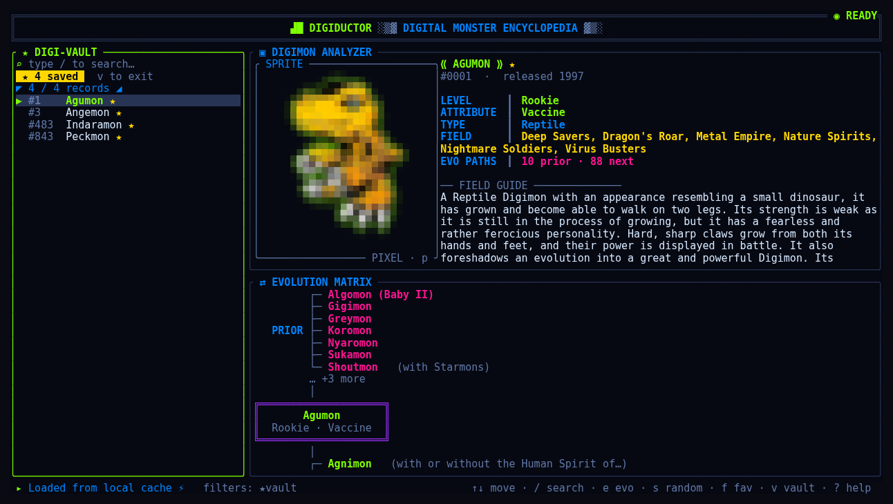

# digiductor

> A cyberpunk **Digimon encyclopedia** for your terminal.

Browse 1,400+ Digimon, follow their digivolution lines and keep favourites in
your own Digi-Vault. Built with [Ratatui](https://ratatui.rs), with live data
from the [Digi-API](https://digi-api.com).



## Features

- **Search and filter** by name, level and attribute.
- **Analyzer**: level, attribute, type, fields, X-Antibody badge, field guide.
- **Evolution Matrix**: jump along the digivolution tree, `⌫` to go back.
- **Digi-Vault**: favourites saved to disk, available offline.
- **Uniform pixel sprites**: every artwork is cut out, pixelated and tinted
  by attribute. Press `p` to switch between `PIXEL`, `HOLO` and `ORIGINAL`.
- **Disk cache** and non-blocking network requests.

| Search + X-Antibody | Holo sprite |
| --- | --- |
|  |  |
| **Evolution Matrix** | **Digi-Vault** |
|  |  |

On terminals with a graphics protocol (Kitty, Ghostty, WezTerm, iTerm2, foot)
sprites are drawn as real pixels; elsewhere they fall back to Unicode half-blocks.

## Install

```bash
git clone <this repo> && cd digiductor
cargo run --release          # or: cargo install --path .
```

## Controls

| Key | Action |
| --- | --- |
| `↑↓` / `jk` | Move |
| `/` | Search |
| `l` / `a` / `x` | Level filter / attribute filter / clear |
| `e` | Evolution matrix (`Enter` jump, `⌫` back) |
| `s` | Random Digimon |
| `f` / `v` | Add to vault / open vault |
| `p` | Sprite style |
| `?` | Help |
| `q` | Quit |

`DIGIDUCTOR_GRAPHICS=on|off` forces the graphics protocol on or off.

## Credits & disclaimer

Data and artwork come live from the [Digi-API](https://digi-api.com); this
repo does not bundle any of them. The screenshots show artwork from that API.
"Digimon" and all related names and imagery are © Bandai / Toei Animation.
This is an unofficial, non-commercial fan project and is not affiliated with them.

The code is under the [MIT License](LICENSE). The licence does not cover the
Digimon data or artwork.
